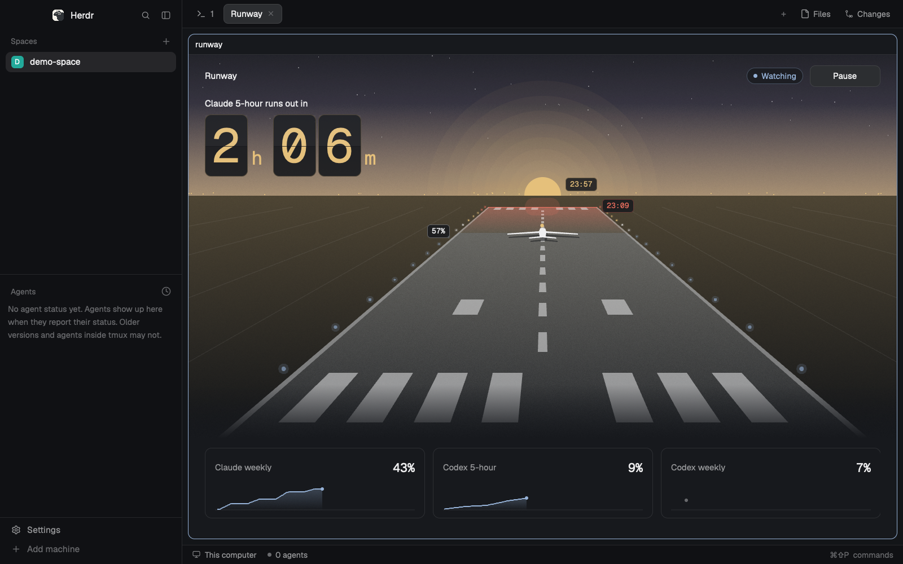

# limit-runway

Forecasts when a Claude Code or Codex plan limit will run out, pauses your agents before it does, and resumes them at reset. A paused Claude Code agent freezes on its next tool call, keeps its context and spends nothing while it waits.

Works on its own, in any terminal. There is also a panel for [Herdr](https://herdr.dev).



## Start

```sh
npx github:adamentwistle/limit-runway status
```

Or install the `runway` command with `npm install -g github:adamentwistle/limit-runway`. It needs Node 22 or later, is tested on 24, and has no dependencies.

```
Claude 5-hour   82%  16.1%/h  hits 100% at 10:03, 2h 4m before reset
Claude weekly   43%   0.5%/h  safe until reset, Mon 14:06
Codex weekly    21%        -  too few samples: 3 over 4m, needs 3 over 60m
```

`runway status --json` gives the same as data, with each limit's `samples` for its current window, thinned to at most 72 points. `--demo` shows made-up numbers.

The forecast comes from samples kept in `~/.limit-runway`. It needs 3 samples over 10 minutes for a 5-hour limit, and over an hour for a weekly one. Until then it says so and guesses nothing. A forecast from just enough samples is marked `(rough)`, and watch won't pause on one.

## Pausing

```sh
runway install-hook --project          # shows the change, writes nothing
runway install-hook --project --yes    # writes it
runway watch                           # says what it would do
runway watch --act                     # does it
```

`watch` only reports until you add `--act`. With `--act` it pauses when a limit reaches 95%, or when a good forecast says 100% within 30 minutes. A limit that resets within 15 minutes is left alone. It resumes a minute after the reset.

`runway pause` pauses by hand, with `--for 30m` or `--until 14:30` if you like. `runway resume` releases everything at once, and watch then leaves that limit alone until it resets.

There are three ways to pause. Use whichever fits each agent.

### 1. Claude Code hook

`runway hook` is a PreToolUse hook. While paused it doesn't return, so the tool call waits and the agent waits with it. It lets go when the pause ends, even if nothing else is running.

- `--project` writes to `.claude/settings.local.json`, because the hook's path is this machine's. `--user` writes to the `settings.json` in your Claude Code config folder. Existing settings stay, and a copy is kept beside the file. `--remove` takes it out.
- With no pause the hook adds about 120 ms to a tool call on a Ryzen 5 1600, nearly all of it starting Node.
- Any failure in the hook lets the tool call through. A bug here must not stop your agent.

How far this goes:

- Claude Code's default hook timeout is 10 minutes, and after that the tool call goes ahead. So `install-hook` sets 8 days. Without that setting a hold fails at 10 minutes.
- At 8 days less a minute the hook denies the call with a reason, rather than let it run.
- The agent stops at its next tool call. A reply already being written finishes first, and a reply with no tool call isn't held.
- A prompt you type while paused still goes to the model, then stops at the first tool call.
- The first request after a long hold will probably miss the prompt cache, so it costs more of your limit than usual. That isn't measured yet.
- Pressing Esc during a hold hasn't been tried.

### 2. Herdr

```sh
runway watch --act --herdr
```

This runs `hc interrupt` on working agent terminals on the plan that's running out, then `hc send` a line at reset. It works for any agent, but it stops the turn, where the hook only freezes it. Claude Code terminals with the hook are skipped. Agents on other machines are skipped unless you add `--machines`. The terminal runway runs in is always skipped.

### 3. Anything else

```sh
runway watch --act --on-pause "./stop-things.sh" --on-resume "./start-things.sh"
```

The commands get `RUNWAY_REASON`, `RUNWAY_UNTIL`, `RUNWAY_LIMITS` and `RUNWAY_PROVIDERS` in their environment.

## The pause file

`~/.limit-runway/pause.json` is the whole state. If it's there, runway is paused, and it says why and until when. Deleting it by hand does the same as `runway resume`, except for the Herdr line and `--on-resume`.

## Settings

`~/.limit-runway/config.json`, all optional. `RUNWAY_HOME` moves the folder.

```json
{
  "pauseAt": 95,
  "forecastMinutes": 30,
  "leaveAloneMinutes": 15,
  "resumeGraceSeconds": 60,
  "intervalSeconds": 60,
  "resumeLine": "Your plan limit has reset. Carry on from where you stopped.",
  "sources": { "orchi": true, "ccstatusline": true, "endpoint": null, "codex": true },
  "herdr": { "machines": false, "skipHooked": true },
  "limits": { "claude.weekly": { "pauseAt": 90 }, "codex.weekly": { "ignore": true } }
}
```

## What it reads and sends

| What | Why |
| --- | --- |
| `~/.cache/orchi/usage.json`, `~/.cache/ccstatusline/usage.json` | Claude usage other tools already keep. Used first, and need no login |
| `~/.codex/sessions` | The end of your newest session files, for rate limit lines only |
| `.credentials.json` in your Claude Code config folder, or on macOS the one keychain entry Claude Code uses | Your login, only when no cache is under 15 minutes old |
| Claude Code settings files | Read only, to see if the hook is installed |

**One thing can go over the network, and only if you agree:** when no cache is fresh, a GET to `https://api.anthropic.com/api/oauth/usage` with your login, at most every 5 minutes. `runway status` asks once in a terminal. `runway login on` and `runway login off` set it, and until then nothing is sent. The address is fixed in the code. Redirects aren't followed, and the login is never refreshed, logged, printed or written anywhere. ccstatusline uses the same call. It isn't a published API, so it can change. With it off, only caches are used, so without ccstatusline or Orchi there are no Claude numbers. `--no-endpoint` turns it off for one run.

**What it writes:** only `~/.limit-runway`: usage samples, the pause file, a log of pauses, and a note per held tool call with its session id, tool name and folder. No prompts, tool input, or tokens. `install-hook --yes` also writes the settings file you name.

## How the forecast works

A forecast only counts if it can be trusted, and the panel and `watch` use the same one, so a burst can't pause anything.

- **Old data:** no forecast when the newest reading is old for its window: over 20 minutes for a 5-hour limit, three and a half hours for a weekly one. It says how old instead.
- **Too little to go on:** no forecast until 5% of a 5-hour window has samples, or 15% of a weekly window has passed.
- **Weekly limits go by pace:** usage so far over the time since the window began, nights and weekends included, so working hours aren't run round the clock.
- **5-hour limits go by the last hour's rate.** With under an hour of history it leans on the window's pace, so a burst in the first minutes isn't taken for the rate.

## Herdr panel

Ask your agent to add it from [herdr.dev/mods](https://herdr.dev/gallery/?type=mods), or point it at this repo. It reads [the recipe](herdr/RECIPE.md) first. By hand, copy `herdr/mods/runway` into `~/.config/herdr-app/mods` and merge `herdr/keys.json` into yours. `ctrl-shift-m` opens it. In that overlay, **Pin to sidebar** puts it in your layout as a side panel, and **Unpin from sidebar** hides it again. On Herdr's shipped layouts it can only show or hide a block that's already there, so duplicate the layout first.

It puts you on a runway at dusk: how far along you are is how much you've used, the far end is 100%, and the sun on the horizon is the reset. The time until the first limit runs out sits on a departures-board display, the lights and sky follow the forecast, and with no forecast there's fog ahead. The other limits sit under it with sparklines, beside the state and a Pause or Resume button. It runs the `runway` CLI through `exec`, and tells you how to install it if it's missing. Pause there includes `--herdr`, so it interrupts working agents.

## Tested

On Windows 11 with Node 24 and Claude Code 2.1.319: real `claude -p` runs held for 703 seconds with the installed timeout, went ahead at 610 seconds without it, released 3 seconds after `runway resume`, and were denied with a reason at the hold limit.

The Herdr panel has run on real readings on Windows, and on macOS with made-up data. Not run yet: the CLI on macOS and Linux, the macOS keychain read on a real Mac, the real usage endpoint, and Pause on live agents through Herdr. Those paths are tested with fakes only. Codex's 5-hour window and its older `resets_in_seconds` field come from its published format. The weekly window was checked against real session files.

`node --test` runs the checks. Nothing in them touches a real login, Herdr or the network.

MIT, see `LICENSE`.
