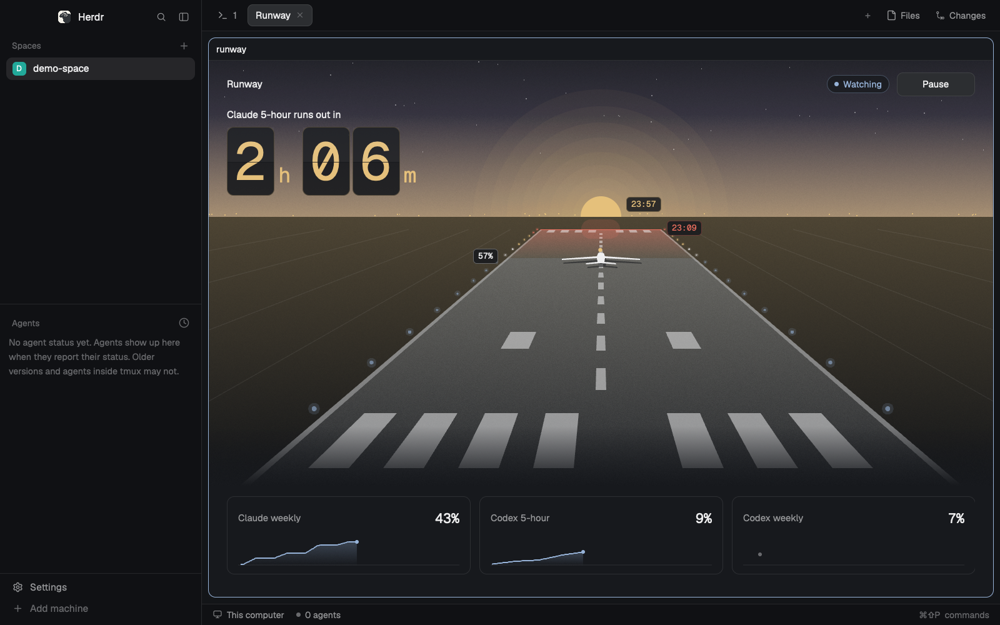

# Runway

A panel that puts you on a runway at dusk. How far along you are is how much of a plan limit you've used, the far end is 100%, and the sun on the horizon is the reset. It says how long until the first limit runs out, and whether agents are paused. One button pauses them and releases them. The numbers and the pausing come from the `runway` CLI, which also works without Herdr.

## What you see

One column on `surface`, from a 320px side panel to a full tab. Colours are theme names only, faded by adding an alpha to the name's value. At 640px wide and up it has 24px side padding, Pause moves into the header, and the other limits become tiles. Below that it has 16px padding, Pause sits full width at the bottom, and the other limits are rows.

- **Scene:** fills the panel down to the other limits, with the header and hero over its sky. All of it is drawn with paths.
  - The sky is a gradient into a glow on the horizon, with stars in dark themes and a line of distant lights.
  - The runway recedes in perspective, with its far end just short of the horizon: threshold bars at both ends, aiming marks, centreline dashes and edge lights down both sides.
  - You're the aircraft, drawn from above and laid on the runway so perspective shapes it, with a chip of your percent. Far off it keeps a size you can read.
  - The sun on the horizon is the reset, with a chip of its time beside it.
- **Moods:** the forecast sets the whole scene, so it reads before any words do.
  - Calm, forecast safe: a teal sky from `accent` and `ansi6`. White lights run as far as the forecast reaches, to a stop bar with a chip of the percent you'll land on, and the lights past it are dim.
  - Warning, runs out but not within the hour: a dusk of `ansi5` into `working`. The lights go white, amber, then red, the far end is red, with a chip of the time you reach it.
  - Danger, inside the hour or at 100%: the glow turns `blocked` and the lights go amber then red.
  - Held, while paused: the sky drains to grey, the lights ahead dim, and a pulsing bar of red stop lights sits in front of the aircraft.
  - Fog, with no forecast: a grey sky, dim lights, and fog over the runway ahead, because there's nothing honest to say about it.
- **Header:** "Runway" in 13px semibold `foreground`. At the right a 24px pill: a 6px dot and the state in 12px medium. "Paused" in `blocked`, "Watching" in `accent`, "Not watching" in `dim`.
- **Hero:** one line of 13px medium `foreground`, then the time on board tiles: one tile for each digit, split across the middle, in Geist Mono, 19% of the panel's width tall, from 62 to 92px. Units are small beside them. Which limit and what it says:
  - The limit that runs out first: "Claude 5-hour runs out in", `2h 06m`. `working` until the last hour, then `blocked`.
  - A limit already at 100%, which comes first: "Claude 5-hour is at 100%. Resets in", `38m`, `blocked`.
  - Every limit forecast safe: "Nothing at risk. Claude 5-hour resets in", `2h 54m`, `accent`.
  - Anything else: the fullest limit and its reset, "Claude weekly resets in", `foreground`, and if that limit's data is old, "No reading for 5h 00m. Claude weekly resets in". There's never a time to 100% without a forecast behind it.
  - No reset known anywhere: the fullest limit's name and its percent.
- **Other limits:** under 640px, 34px rows of name, a 72 by 22 sparkline and the percent. From 640px, tiles of 104px with the name, the percent at 18px and a 40px sparkline, up to four across, in two lines before they scroll. A limit that's running out adds its time in its colour, and an old one adds how old it is. Sparklines run across the window, scaled to their own level, in the limit's colour: `accent`, `working` or `blocked`, and `dim` with no forecast. Under 430px of height the rows go, so the scene and control stay.
- **Pause line:** only while paused, 12px `foreground`, such as "Paused until 13:40. 2 tool calls held." The reason is left out, because the scene already shows it.
- **Problem line:** only after a failure, 12px `blocked`.
- **Control:** a 32px button, radius 8, 12.5px medium. `Pause` on `raised` with a `border`, `Resume` on `solid`, `Pausing` and `Resuming` while it works. A press on `Pause` swaps it for `Cancel` on `raised` and `Interrupt agents` on `blocked`.
- **Pin:** only in the overlay, a full width button of the same kind under the control, on `raised` with a `border`: `Pin to sidebar`, or `Unpin from sidebar` while a runway block shows in the layout.

With no limits it reads "No limits found." Before the first answer it reads "Reading". With no CLI it reads "The runway CLI isn't installed." and, under it in 12px Geist Mono `muted`, `npm install -g github:adamentwistle/limit-runway`, with no button.

## How it behaves

- **Agent status:** it doesn't read Herdr's agent status. Working, blocked, done and idle agents all look the same here. The state is runway's own: paused, watching or not.
- **Reading:** it runs `runway status --json` on opening and every 60 seconds. Each read also adds a sample to the CLI's history, so an open panel builds up the forecast and the chart.
- **Sparkline data:** each limit in the reply has `samples`, `[{ t, used }]`, the current window from the CLI's history, thinned to at most 72 even steps of time. The times come from the reply's `now`, so the words and the scene agree between reads.
- **Forecast:** shown only when the CLI has one, and the panel never works one out. The CLI gives none when the newest reading is old for its window, or when too little of the window is covered. A window of a day or more goes by its pace, usage so far over the time since it began, so a burst of work isn't run round the clock. See the README.
- **Pause:** asks first, because it stops turns. `Interrupt agents` runs `runway pause --herdr --json`, then reads again. `Cancel` does nothing. `Resume` doesn't ask. Agents with the Claude Code hook freeze on their next tool call. Other working agents on this machine are interrupted. It holds until someone presses Resume.
- **Resume:** runs `runway resume --json`, then reads again.
- **A pause whose time is up:** if the reply says `due`, it runs `runway resume --due --json`, which sends the resume line to interrupted terminals. It does nothing else by itself. It never starts a pause. For that, run `runway watch --act`.
- **A failed read:** the last good numbers stay, with the problem under them.
- **Pin to sidebar:** reads `layout()` on every render, so it's right after a hide from anywhere else. Where the shown layout has a runway block it runs `layout.show` on it and on any hidden parent, and Unpin runs `layout.hide`. Where it has none and the layout is the person's own, Pin adds `{ "id": "runway", "type": "block", "size": { "px": 340 }, "min": 320, "max": 640, "content": { "mod": "runway" } }` at the right end of the row that holds the terminals, beside the side panel, with `layout.set`, and Unpin then hides it. Where it has none and the layout is shipped (`main`, `terminals`, `win98`), there's no button, because a shipped layout won't take it.
- **Keys:** `ctrl-shift-m` opens it, again closes it, and so does Esc. `runway.pin` presses Pin in the open overlay.
- **Motion:** lights chase up the centreline from you toward the far end, faster as it gets urgent. The sun breathes, the far end pulses in a warning or danger, and the stop bar pulses while held. All of it is native, from `.frames` and `.loop`, and stops when it isn't drawn. Held and fog have no chase. No timer redraws anything.

## Built from

- One mod, `mods/runway/`, with no layout. `mod.json`: `{ "place": "right", "size": 340, "title": "Runway", "overlay": { "width": 360, "height": 540 } }`. `keys.json`: `{ "global": { "ctrl-shift-m": "mod.open:runway" } }`.
- `props`: `{ "demo": true }` uses made-up limits and needs no CLI. So do `"paused"`, `"confirm"`, `"safe"`, `"limit"`, `"few"` and `"stale"`, one for each state. `{ "command": "C:/full/path/runway.cmd" }` names the CLI.
- To open it beside a terminal: `herdr-app do pane.split '{"direction":"right","mod":"runway"}'`.
- `main.js`: the state, the one timer, the CLI calls. `logic.js`: arguments, reply reading, the hero, the mood, the runway's perspective, the lights, with no Herdr imports. `view.js`: the drawing. `demo.js`: the made-up limits, on the same curves as the CLI's `src/demo.js`.
- From `herdr`: `exec`, `props`, `settings`, `theme`. From `gpui-kit`: `View`, `div`, `PathBuilder`, `Background`, and `window.paint_path`. From `gpui-base`: `h_flex`, `v_flex`. From `os`: `platform`. Also from `herdr`: `layout`, `shared("layout")`, `nextCommand` and `run`, only for `layout.show`, `layout.hide` and `layout.set` from Pin. `pin.js`: what Pin does, with no Herdr imports.
- Programs: `runway` on macOS and Linux, `runway.cmd` then `runway` on Windows. No python.
- No art. Geist and Geist Mono ship with Herdr.

## Watch out

- **Tell the person before adding it.** It runs the `runway` CLI. The CLI reads usage caches, Codex session files and Claude Code settings outside the mod's folder, and writes to `~/.limit-runway`. If the person has run `runway login on`, or said yes when `runway status` asked, then when no usage cache is fresh it sends their Claude Code login to `https://api.anthropic.com/api/oauth/usage`, at most every 5 minutes. Until then it sends nothing, and the panel shows a note saying so. The mod itself makes no network calls. Pause interrupts working agents, which stops their turn.
- **`place: right` doesn't dock on Herdr's shipped layouts.** On `main` in 0.1.13, a new mod folder left the layout as it was, both at start and with the window open, and shipped layouts can't take tree edits. That's why it has an overlay and a key. It docks only on a person's own layout.
- **`exec` doesn't use the shell's PATH.** It uses the user's real environment, so a CLI that only a shell setup puts on PATH, such as an `npm -g` under fnm or nvm, shows as not installed. Use `props.command` in a layout block, or put npm's global folder on the user PATH. `mod.open` takes only a name, so the overlay can't be given props.
- **Windows starts programs by exact name.** npm's launcher there is `runway.cmd`, so that's tried first. Windows has no `python3`, which is one reason this mod has no helper script.
- **`herdr-app check` writes `jsconfig.json` and `gpui-kit.d.ts` into the mod folder.** They're in `.gitignore`.
- **The home's path must be short.** A long `HERDR_APP_HOME` leaves the window with no control socket (one of about 110 characters failed, one of 34 worked): "path must be shorter than SUN_LEN". The window opens, but `status`, `shot` and `app.quit` can't reach it, so it has to be closed by hand.
- **No `setTimeout`, `clearTimeout` or `setInterval`.** A test greps for them. The limit on `exec` is a race with `cx.sleep`.
- **`exec` stops at 30 s.** The CLI's slowest case is a 10 second endpoint timeout, or `hc interrupt` on several terminals, which run at once with a 5 second limit each.
- **Zoom.** `on_size_change` reports window pixels, while `.w()`, `.left()` and text are the app's own, scaled by `settings().zoom`, so the view divides measured sizes by the zoom and lays everything out in the app's own. The 640px switch to tiles is in the app's own too. Herdr's default of 1.2 breaks anything that skips this, and a window at 1.0 hides it.
- **Path coordinates are percents of the path's own box.** On Windows in 0.1.13, plain path numbers are scaled by the zoom like everything else, so multiplying them by it overshoots. A percent lands the same whichever way a platform treats a number. Stroke widths and dashes stay plain numbers.
- **The scene measures itself.** It has `on_size_change` of its own, because flex decides its height, and draws nothing until the first answer.
- **Gradient stops are fractions, and there are only two.** `Background.stop(colour, 0.5)`, not 50. Any stop past 1 shows as a solid colour. The gradient covers the path's own bounding box. Angle 180 runs top to bottom, 90 left to right.
- **`.bg()` takes a colour, not a `Background`.** Gradients and hatching go through `window.paint_path`.
- **`.loop` has no phase, so a chase uses `.frames`.** Each light has the same list with its own step lit, and every view shares one clock.
- **A width transition didn't run on the scene.** A wipe on open was tried with px and percent widths, with the transition after the width, and from a render painted at no width. The width jumped each time, so it was dropped.
- **A render past the limit shows in the frame, not in `status`.** Herdr prints "This view could not be re-rendered: interrupted" on the panel, while `herdr-app status` still says `"errors": []`. Every point in a path costs time, and a cold first render costs most: the first build took it past the limit at 130 polygons of 14 points. So stars are one stroke, far lights are diamonds, the backdrop is built in the size callback, and a reading only rebuilds what it changes.
- **Herdr can take frames from a hidden desktop.** Started on its own Windows desktop with `CreateDesktop`, a window paints and answers `shot` with no effect on the person's focus.
- **A scroller grows to its `max_h`.** The rows and tiles have an explicit height.
- **A minimised window stops painting, and `shot` then returns its last frame.** Compare frames over time before trusting one.

## Done when

- `herdr-app check mods/runway` passes.
- `node --test` passes from the repo's root.
- `ctrl-shift-m` opens the overlay and the key closes it again.
- In the overlay, Pin to sidebar shows the runway block and the button reads Unpin from sidebar, and Unpin hides it again. On a shipped layout with no block there's no button.
- With the CLI missing, it shows the install line and no button.
- With the CLI present, it shows the hero, the runway and the other limits, and the state reads "Not watching", or "Watching" while `runway watch --act` runs.
- After `runway pause --for 20m` in a terminal, the next read shows "Paused", the pause line and `Resume`.
- `Resume` clears the pause, and `~/.limit-runway/pause.json` is gone.
- Opened with `{ "demo": true }`, the hero reads `2h 06m` over a dusk sky, with the aircraft at 57% and red lights at the far end. With `{ "demo": "paused" }` it reads `13m` at 96%, grey, with the stop bar. Neither asks the CLI anything.
- With `{ "demo": "few" }` or `{ "demo": "stale" }` there's fog ahead, no chase, no crossing and no landing, and it doesn't say nothing is at risk.
- From 320px to a full tab, in light and dark, at zooms from 1.0 to 1.5, nothing overlaps and the control stays on screen.
- With the pause over and nothing else running, the next read runs `resume --due` and the panel goes back to `Pause`.
